# Screenshots

Taken from the installed app on a tablet. Site names, server names and addresses have been changed.

## The main screen

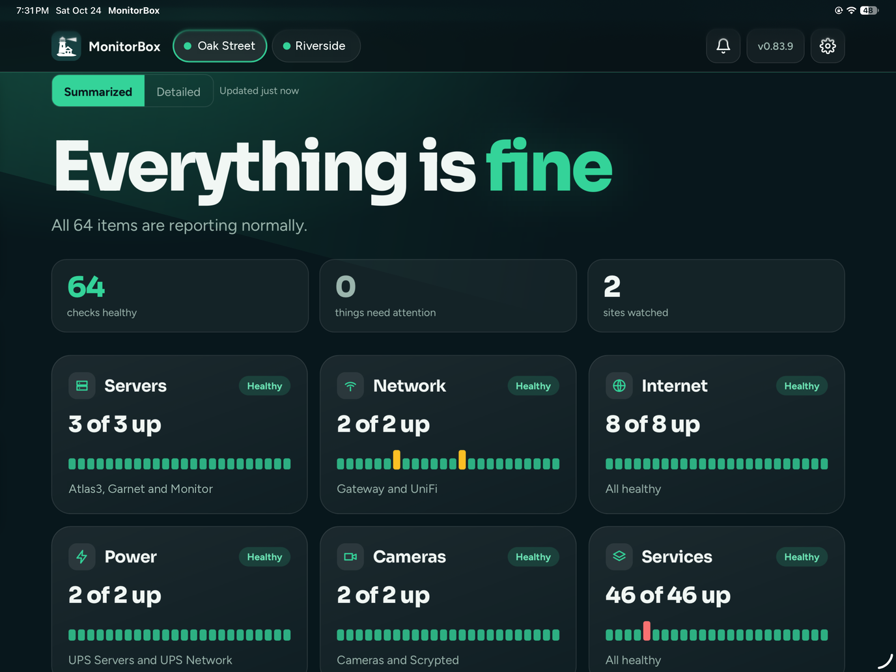

Green: everything is fine. Each tile is a group (Servers, Network, Internet, Power, Cameras, Services). The coloured bars are the last day, so a short yellow or red mark shows when something blipped.

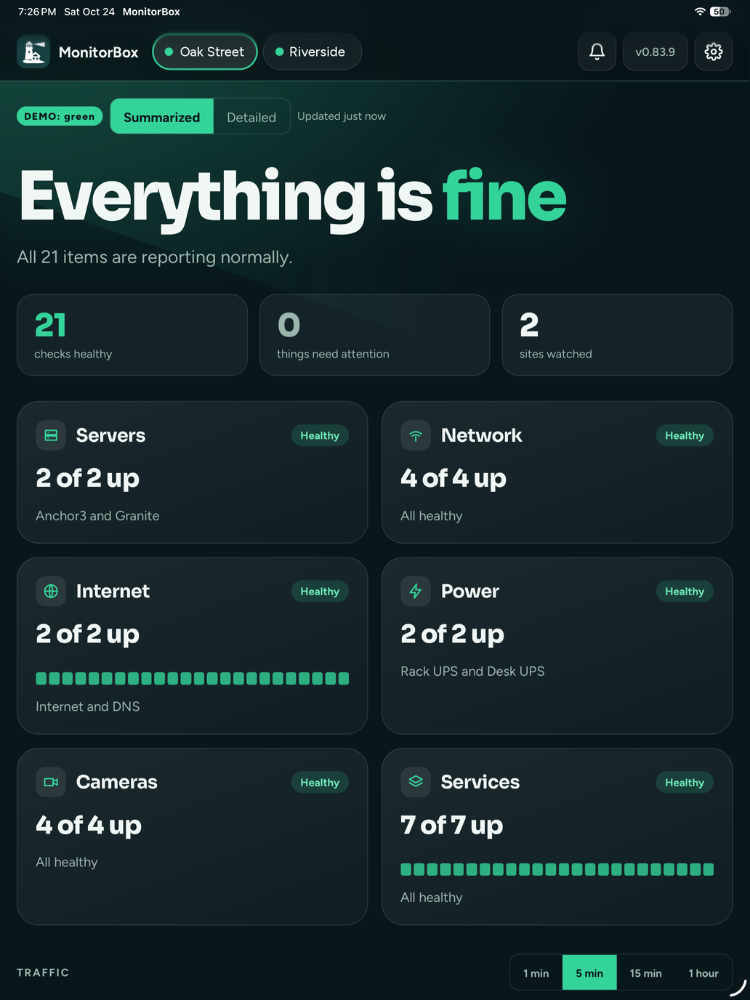 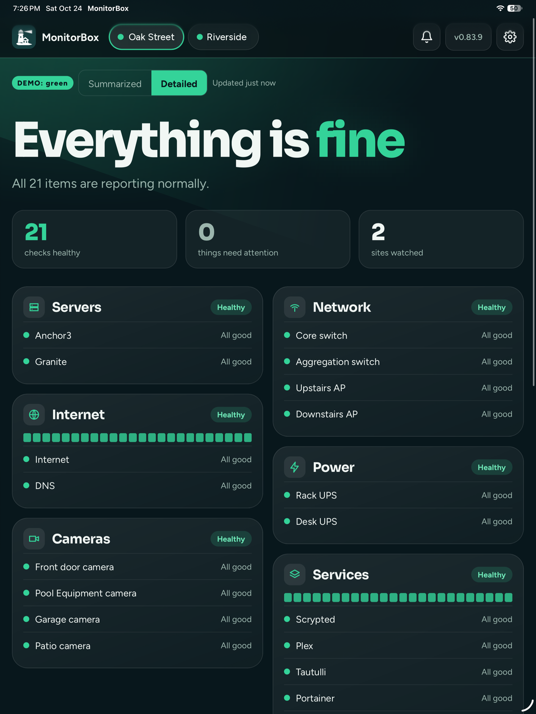

Summarized (left) and Detailed (right) views of the same screen.

## When something is wrong

Each site has a tab with its own colour, so you can see which place needs attention without opening it.

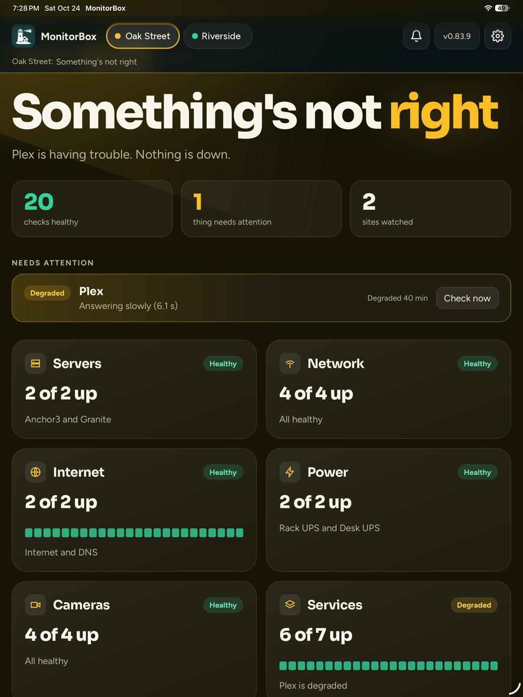 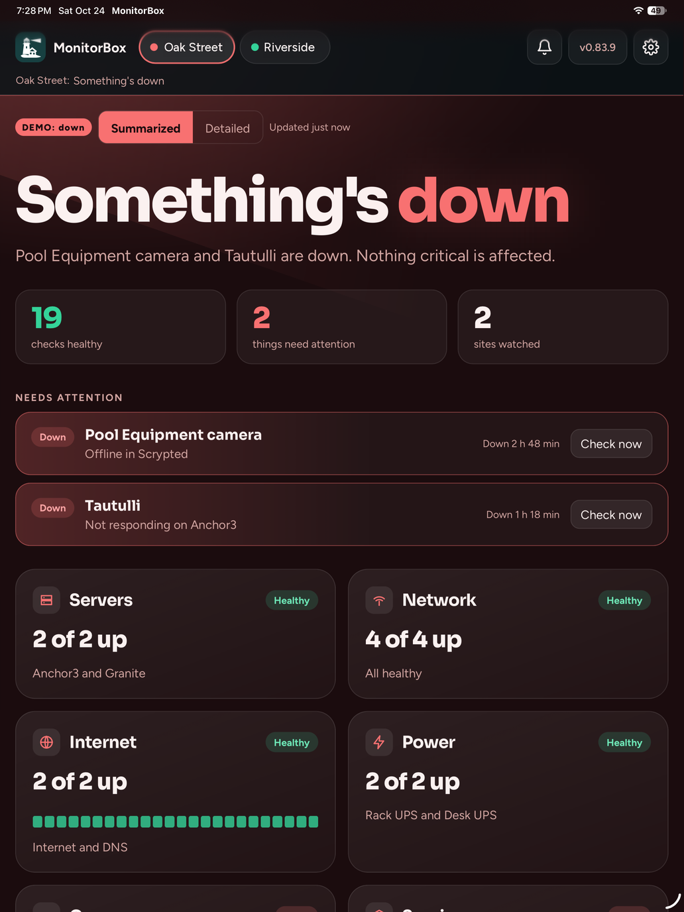 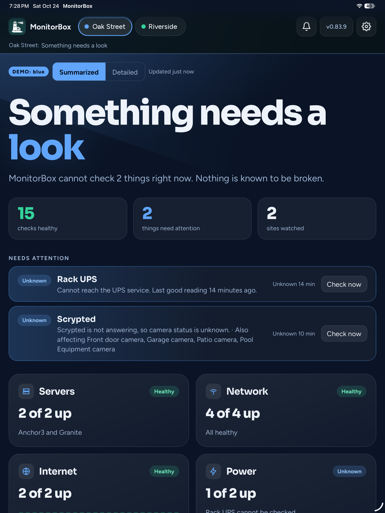

Yellow: something is not right. Red: something is down. Blue: something needs a look (MonitorBox could not check it, so it says so instead of guessing).

## Traffic

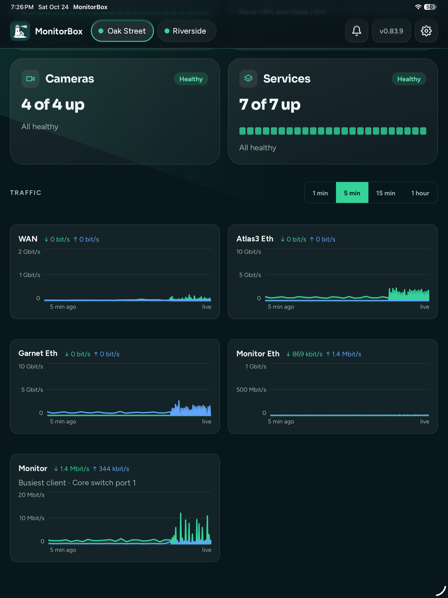

Live traffic for the internet connection and for each server, plus the busiest client on a switch port.

## Servers

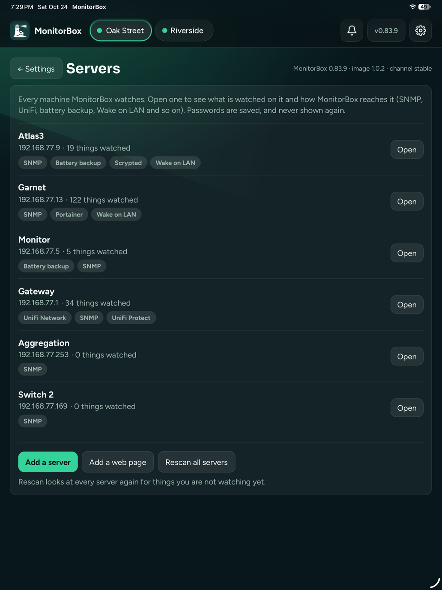

Every machine MonitorBox watches, what it found on each one, and how many things are watched.

## History

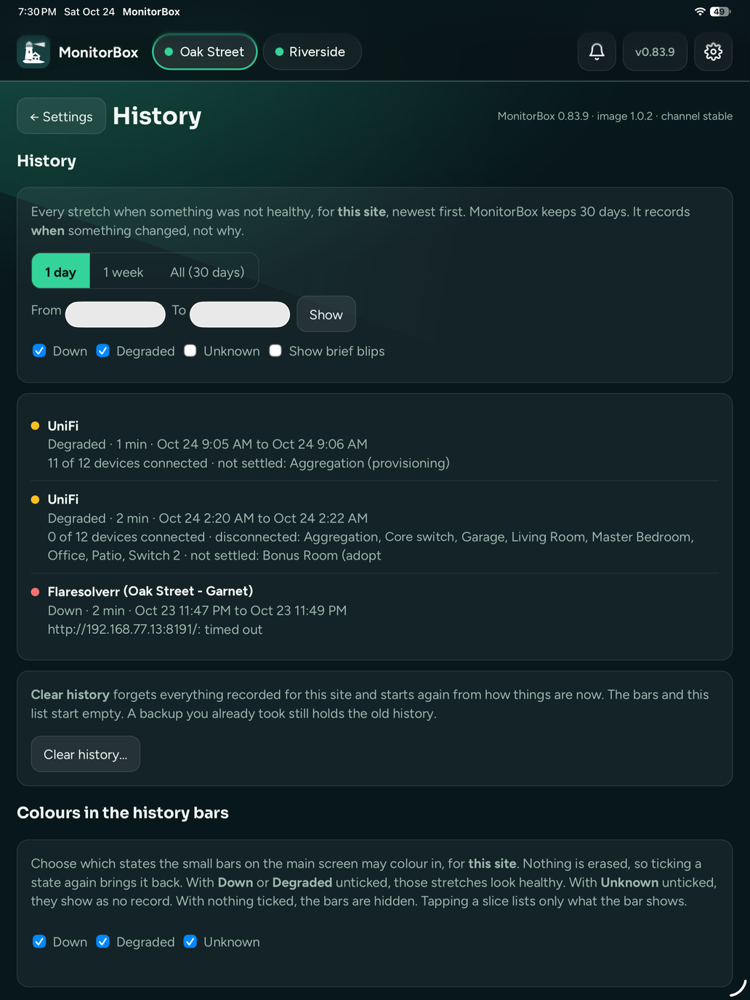

What happened, when, and for how long.

## Settings, backups and updates

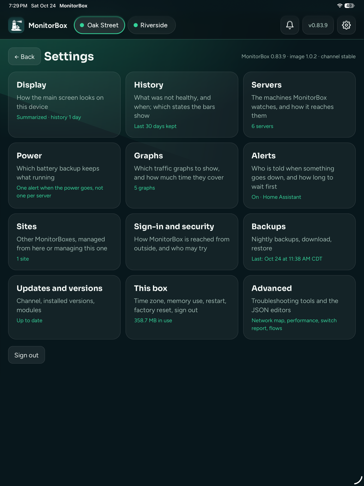 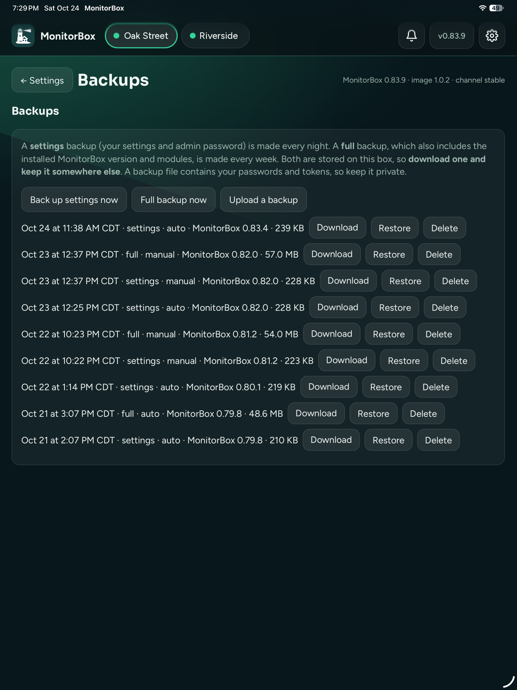 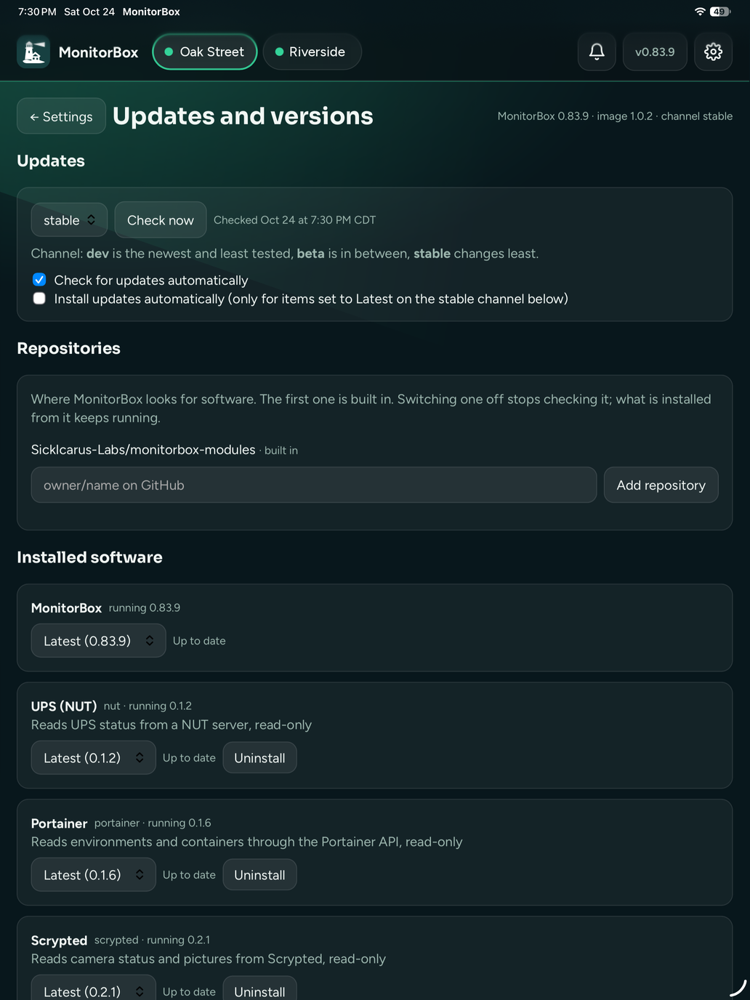
